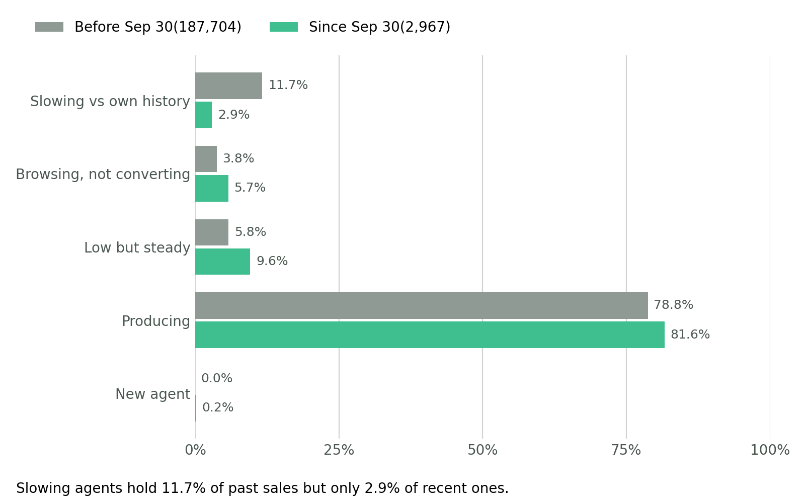

## AGENTS/USER BEHAVIOR SINCE SEPTEMBER 30TH
This analysis examines 420 agents on the *Low Frequency (Browse Over Buy)* tab of the warehouse-verified extract dated October 8, 2026, identifying those who browse products on PWA but create relatively few policies, and distinguishing declining business from consistently low sales.

Since PWA product-view tracking began around September 30, 2026, sales before this date represent historical performance, while sales since then indicate recent activity.

Browsing, quotes, policies created, and paid business are treated as separate signals. Viewing products or creating a policy does not necessarily mean a sale was completed or paid.

### DATA UNDERSTANDING

The tab holds 420  agents, one row each, with 10 columns and no duplicate rows, names, emails or phone numbers. Every agent made at least one sale since September 30 and viewed at least 2 products, so the tab is a filtered group, not the full agent roster.

#### *Source and Scope*

- File: 'Lami- Droppers + Low-freq buyers(warehouse-verified, Oct 8 2026)' second sheet. The first sheet holds 151 agents with no sales since September 30th.

- Period: Since September 30th to 0ctober 8th, 2026(about 8 days), inferred from the column names and the file date. No row carries a date.

- Sort order: by viewed_per_sale, highest first.
- Comparison point: te earlier 'Dropper lists (September 30-Oct 3 2026)' sheet , where 269 of these agents also apppear.

#### *Activity versus business*

• Activity: 5,773 view events. Shows interest only.

• Intent: 176,636 lifetime quotes. Undated, and 180 agents have more sales than quotes, so quotes do not capture every sale.

• Policies created: 2,967 since Sep 30. The tab does not say whether they were paid or which platform they came from.

• Paid business: not on this tab. Hand checks from Oct 3 cover 34 of these agents: 301 sales, 53 unpaid, 268 on the PWA and 33 on the old platform.  

### PROBLEM STATEMENT 

LAMI cannot yet tell which agents are losing business and which are still producing, because the data mixes browsing, quotes and policies written, and does not record payment or platform. Every agent on this tab sold at least once since Sep 30, so the risk is a slowdown, not a full stop: an agent who sold hundreds of policies before Sep 30 and only 1 or 2 since looks active on a simple "has sales" check.

The analysis needs to answer five questions:

1. Which agents browse heavily on the PWA but write few policies since Sep 30?

2. Which agents are selling far below their own history before Sep 30?

3. Which agents are actively generating business, and what share of recent sales do they account for?

4. How much of each agent's recorded activity is actual business: policies created, and of those, how many are paid?

5. Where is platform attribution unclear, so that an apparent drop may be selling on the old platform instead?

A good result is a named, prioritised list of slowing and non-converting agents for follow-up, with each classification shown alongside the evidence behind it and its known gaps.

## FINDINGS
### Sales share before and since September 30th

